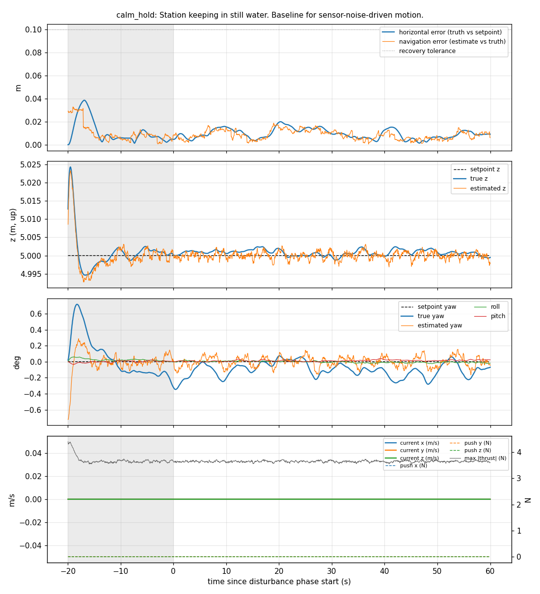
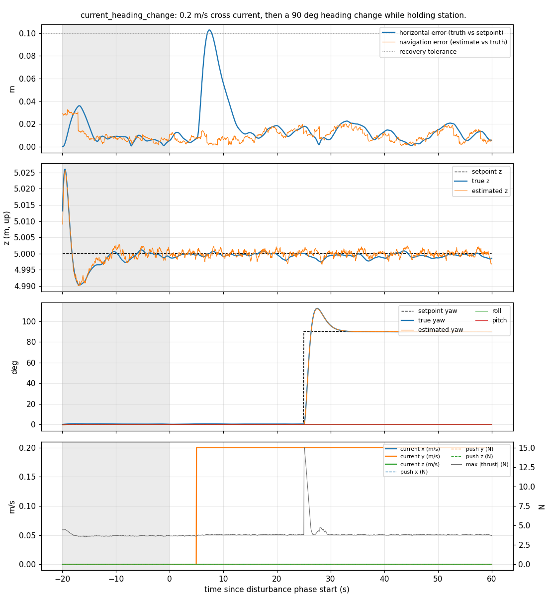
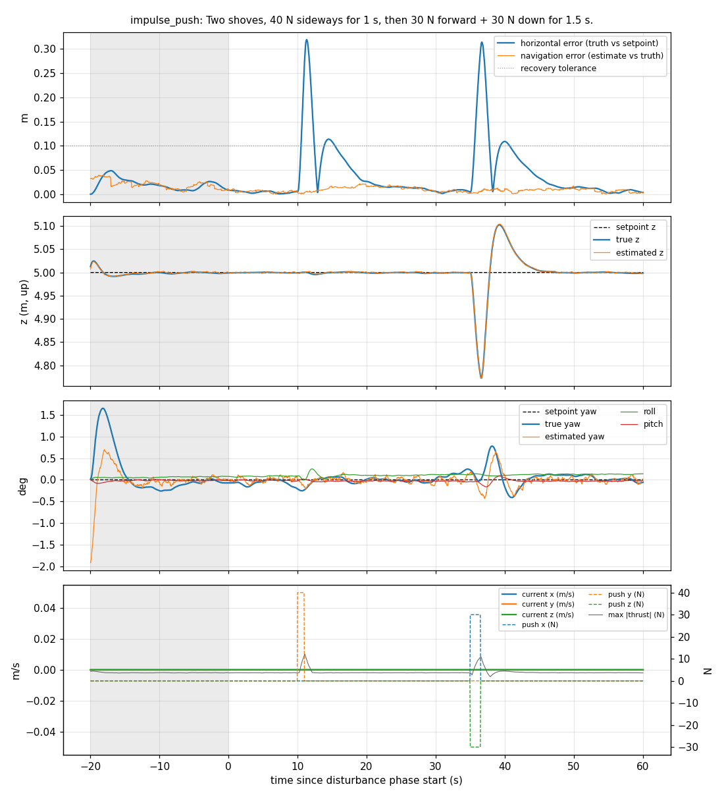
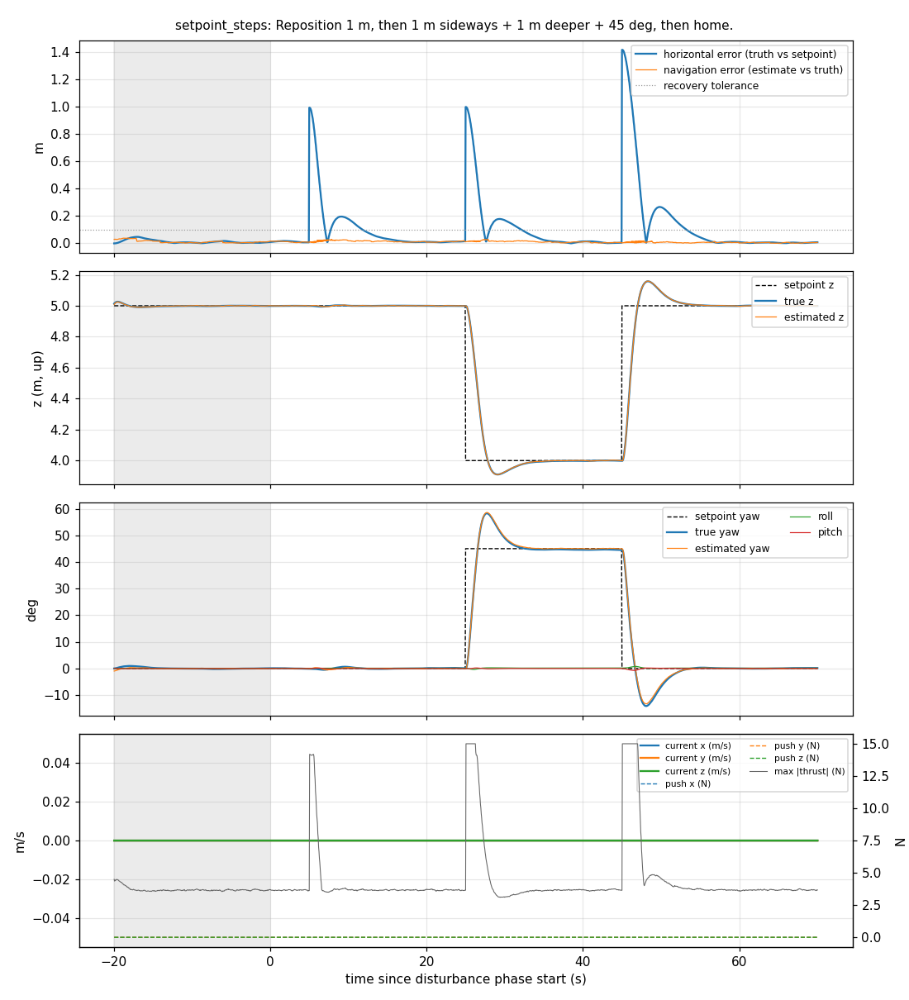
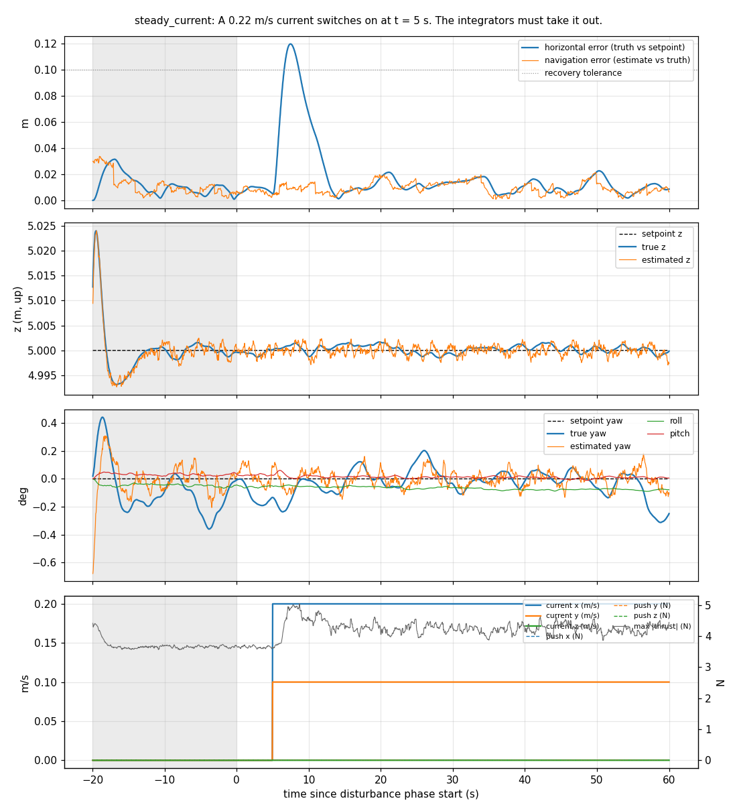
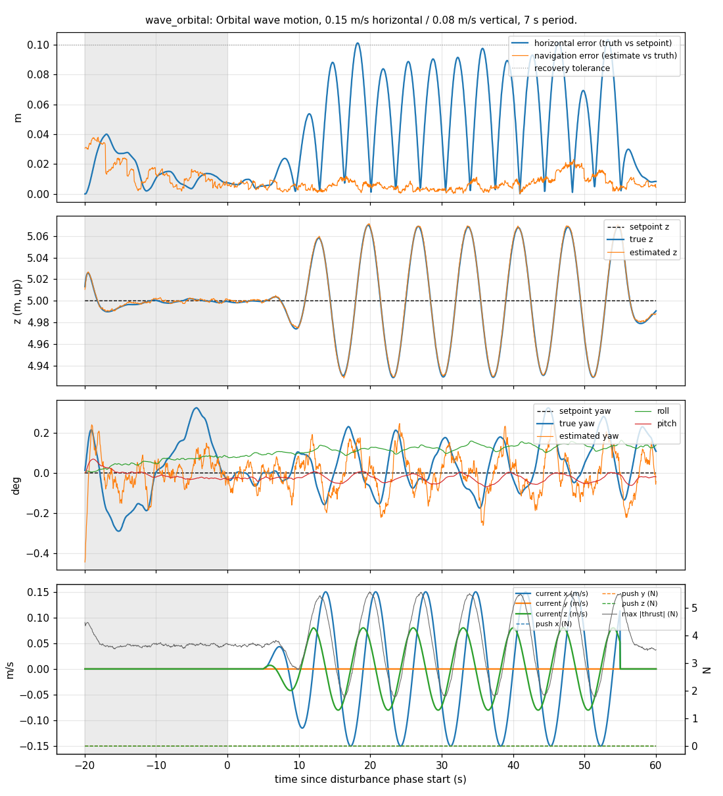

# Hover controller validation

Errors are ground truth vs. setpoint over the disturbance phase. The controller runs on the navigation estimate only (IMU + magnetometer AHRS, DVL, pressure depth and USBL fused by the Kalman filter).

| scenario | result | horizontal_rms (m) | horizontal_max (m) | final_horizontal_rms (m) | depth_max (m) | yaw_max_deg (deg) | tilt_max_deg (deg) | recovery_time (s) | nav_position_rms (m) | saturation_fraction |
|---|---|---|---|---|---|---|---|---|---|---|
| calm_hold | PASS | 0.010 | 0.020 | 0.008 | 0.002 | 0.35 | 0.04 | n/a | 0.009 | 0.0 % |
| current_heading_change | PASS | 0.027 | 0.103 | 0.012 | 0.003 | 89.57 | 0.12 | n/a | 0.011 | 0.2 % |
| impulse_push | PASS | 0.073 | 0.319 | 0.014 | 0.228 | 0.78 | 0.25 | 4.40 | 0.010 | 0.0 % |
| setpoint_steps | PASS | 0.272 | 1.415 | 0.011 | 1.002 | 44.93 | 0.78 | 8.25 | 0.012 | 4.6 % |
| steady_current | PASS | 0.030 | 0.119 | 0.011 | 0.002 | 0.31 | 0.09 | 3.60 | 0.010 | 0.0 % |
| wave_orbital | PASS | 0.056 | 0.103 | 0.056 | 0.071 | 0.32 | 0.16 | n/a | 0.008 | 0.0 % |

**Overall: PASS** (6 scenarios)

## calm_hold

Station keeping in still water. Baseline for sensor-noise-driven motion.

| metric | value | limit |
|---|---|---|
| horizontal_rms | 0.010 | 0.05 |
| horizontal_max | 0.020 | 0.15 |
| final_horizontal_rms | 0.008 |  |
| depth_rms | 0.001 |  |
| depth_max | 0.002 | 0.05 |
| yaw_rms_deg | 0.14 |  |
| yaw_max_deg | 0.35 | 2.0 |
| final_yaw_max_deg | 0.28 |  |
| tilt_max_deg | 0.04 | 3.0 |
| nav_position_rms | 0.009 | 0.08 |
| nav_yaw_rms_deg | 0.13 |  |
| saturation_fraction | 0.0 % |  |

## current_heading_change

0.2 m/s cross current, then a 90 deg heading change while holding station.

| metric | value | limit |
|---|---|---|
| horizontal_rms | 0.027 |  |
| horizontal_max | 0.103 | 0.4 |
| final_horizontal_rms | 0.012 | 0.06 |
| depth_rms | 0.001 |  |
| depth_max | 0.003 | 0.1 |
| yaw_rms_deg | 9.57 |  |
| yaw_max_deg | 89.57 |  |
| final_yaw_max_deg | 0.22 | 3.0 |
| tilt_max_deg | 0.12 |  |
| nav_position_rms | 0.011 |  |
| nav_yaw_rms_deg | 0.30 |  |
| saturation_fraction | 0.2 % |  |

## impulse_push

Two shoves, 40 N sideways for 1 s, then 30 N forward + 30 N down for 1.5 s.

| metric | value | limit |
|---|---|---|
| horizontal_rms | 0.073 |  |
| horizontal_max | 0.319 | 0.5 |
| final_horizontal_rms | 0.014 | 0.05 |
| depth_rms | 0.037 |  |
| depth_max | 0.228 | 0.4 |
| yaw_rms_deg | 0.16 |  |
| yaw_max_deg | 0.78 |  |
| final_yaw_max_deg | 0.13 |  |
| tilt_max_deg | 0.25 |  |
| nav_position_rms | 0.010 |  |
| nav_yaw_rms_deg | 0.13 |  |
| saturation_fraction | 0.0 % |  |
| recovery_time | 4.40 | 12.0 |

## setpoint_steps

Reposition 1 m, then 1 m sideways + 1 m deeper + 45 deg, then home.

| metric | value | limit |
|---|---|---|
| horizontal_rms | 0.272 |  |
| horizontal_max | 1.415 |  |
| final_horizontal_rms | 0.011 | 0.05 |
| depth_rms | 0.167 |  |
| depth_max | 1.002 |  |
| yaw_rms_deg | 6.94 |  |
| yaw_max_deg | 44.93 |  |
| final_yaw_max_deg | 0.32 |  |
| tilt_max_deg | 0.78 | 5.0 |
| nav_position_rms | 0.012 |  |
| nav_yaw_rms_deg | 0.33 |  |
| saturation_fraction | 4.6 % |  |
| recovery_time | 8.25 | 15.0 |

## steady_current

A 0.22 m/s current switches on at t = 5 s. The integrators must take it out.

| metric | value | limit |
|---|---|---|
| horizontal_rms | 0.030 |  |
| horizontal_max | 0.119 | 0.4 |
| final_horizontal_rms | 0.011 | 0.06 |
| depth_rms | 0.001 |  |
| depth_max | 0.002 | 0.1 |
| yaw_rms_deg | 0.11 |  |
| yaw_max_deg | 0.31 | 3.0 |
| final_yaw_max_deg | 0.31 |  |
| tilt_max_deg | 0.09 |  |
| nav_position_rms | 0.010 |  |
| nav_yaw_rms_deg | 0.10 |  |
| saturation_fraction | 0.0 % |  |
| recovery_time | 3.60 | 25.0 |

## wave_orbital

Orbital wave motion, 0.15 m/s horizontal / 0.08 m/s vertical, 7 s period.

| metric | value | limit |
|---|---|---|
| horizontal_rms | 0.056 | 0.15 |
| horizontal_max | 0.103 | 0.3 |
| final_horizontal_rms | 0.056 |  |
| depth_rms | 0.043 |  |
| depth_max | 0.071 | 0.15 |
| yaw_rms_deg | 0.12 |  |
| yaw_max_deg | 0.32 | 3.0 |
| final_yaw_max_deg | 0.32 |  |
| tilt_max_deg | 0.16 |  |
| nav_position_rms | 0.008 |  |
| nav_yaw_rms_deg | 0.11 |  |
| saturation_fraction | 0.0 % |  |

